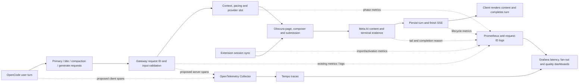

# Meta AI performance telemetry and optimization plan

## Decisions and implementation status

Measure one **user turn**, every model request it causes, and each provider attempt.
A user turn can contain a primary answer, title generation, retries and eventually
other auxiliary work. A fast HTTP 200 or an SSE `[DONE]` alone is not proof of a
correct, complete answer. Keep latency, completion correctness and failure rates
on the same dashboard.

The first release uses the gateway's existing Prometheus endpoint and structured
request-ID logs. It adds useful latency buckets through 300 seconds, bounded
request-purpose counters, server request-to-first-content timing, pacing/slot/
provider-context/backend-admission/persistence phase timings, and completion-decision
reasons. The synthetic SSE benchmark validates output and terminal events.
No exporter SDK or synchronous remote telemetry operation is added to chat handling.

The complete client-turn trace, client-visible timestamps, in-flight/cancellation
metrics, resource exporter, Prometheus/Grafana deployment and OpenTelemetry Collector/
Tempo integration below are **proposed next stages**, not services installed by
this release. Existing server metrics alone cannot produce exact user-turn fan-out
or client-render latency. Do not label those gaps as measured.

## Architecture



Scrape every 15 seconds; retain aggregate metrics for 14 days initially. Retain
content-free request logs/traces for 3 days. Start with 100% failed traces and 10%
successful traces once tracing is implemented, with a bounded collector queue.
Never block a chat on an exporter. Track dropped telemetry and sampling coverage.
Export only allowlisted application performance events. Exclude raw Obscura
JavaScript console messages, upstream bodies and network-debug logs.
Use a local/private monitoring listener and the existing admin key when `/metrics`
authentication is enabled; do not expose operational telemetry publicly.

Resource metadata should include service version, source SHA, instance and telemetry
schema version. Keep release metadata in resource/build information, not a new
high-cardinality histogram label on every deployment.

## Clock and correlation contract

Use monotonic elapsed durations in each process. Correlate records with the gateway's
returned `x-request-id`; it is generated by the gateway, not trusted from a caller.
A proposed ephemeral `turn_id` and W3C trace context will join the client root turn,
its model requests and retries. Do not export OpenCode session IDs, conversation IDs,
account IDs or a stable user identifier. Never subtract client and server wall-clock
timestamps to calculate a duration.

The OpenCode adapter reports `X-Chat-Gateway-Request-Kind` with one of `primary`,
`title`, `compaction` or `generate`. The canary uses `canary`. Missing/unknown values
become `unspecified`. This header is an **untrusted diagnostic hint**; it grants no
permissions and changes no routing or provider policy.

## Metric catalog

All durations below have explicit start/end boundaries. Existing Prometheus names
remain in milliseconds for compatibility. Convert them to seconds in dashboards.
New OpenTelemetry instruments should use seconds and semantic conventions where
applicable; application-specific browser stages remain explicit custom spans.

| Metric or signal | Boundary / purpose | Coverage |
| --- | --- | --- |
| Client turn E2E | User submits to successful terminal event rendered | Proposed client root span; CLI benchmark is an external test, not TUI instrumentation |
| Client TTFT | User submits to first nonempty assistant content rendered | Proposed client event; streaming test measures bytes arriving at its client |
| Server request TTFT | Gateway handler start to first backend content available; includes context, pacing and queues | New `gateway_request_ttft_ms{provider,kind,transport}` |
| Provider TTFT | Provider attempt start to first content, excluding earlier pacing/slot waits | Existing `gateway_provider_ttft_ms` |
| HTTP handler duration | Middleware entry to returning response headers/body object | Existing `gateway_http_handler_duration_ms`; **not full SSE duration** |
| Chat total | Handler start through provider terminal and durable persistence | Existing `gateway_chat_total_duration_ms` and request completion log |
| Pacing wait | Provider request reservation/jitter/rate spacing await | New `gateway_chat_phase_duration_ms{phase="pacing"}` |
| Provider slot wait | Pacing end to permit acquisition or returned busy error | New phase `slot`; existing provider queue metric also remains |
| Browser page lock | Waiting for the browser provider page lock | Existing `gateway_provider_page_lock_duration_ms` |
| Provider context | Thread lookup/planning under the provider permit | New phase `provider_context` |
| Backend admission | Starting backend send to obtaining its event channel/error | New phase `backend_admission`; nested inside provider work |
| Page warm/cache/navigation | Queue, cache hit/miss, navigate, composer ready | Proposed browser spans and cache counters |
| Composer fill and acknowledgement | Fill start to exact retained draft; send to fresh user turn | Proposed separate browser spans; existing fixed failure-stage logs |
| Active generation | First content to last content; output bytes and deltas | Synthetic benchmark; proposed client/server generation histogram |
| Inter-delta gap | Gap between nonempty content deltas, including longest gap | Benchmark maximum gap; aggregate streaming histogram proposed; deltas are **not tokens** |
| Response extraction/cleaning/serialization | DOM extraction, response cleanup and JSON/SSE encoding | Existing DOM evaluation histogram is partial; dedicated sub-spans proposed |
| Session import/activation | Sync queue, vault persistence, activation and retained activation gate | Existing relay import phase histograms |
| Completion tail | Last emitted provider delta to provider done | Existing `gateway_provider_tail_ms`; benchmark also measures client last-content to `[DONE]` |
| Completion reason | Browser decides terminal via fallback idle or explicit evidence | New `gateway_provider_completion_decisions_total{provider,reason}` |
| Persistence | Durable transcript write and provider-thread sync, including returned errors | New phase `persistence` and request-correlated persistence log |
| Client stream drain/render | Gateway/client terminal arrival to UI turn end | Proposed client span |
| Model request purpose | Validated chat API inputs by kind and SSE/JSON transport | New `gateway_chat_input_requests_total{kind,transport}`; counts requests, not user turns |
| Fan-out per turn | All model calls divided by measured client user turns | Proposed client turn metric; request-kind counters alone are insufficient |
| Retries and backoff | Attempts per turn; time sleeping between attempts | Proposed client retry counters/spans; preserve failed attempts in reports |
| Input/output volume | Byte/character counts, estimated tokens, history size | Content-free request-size log; benchmark output chars; input/output histograms proposed |
| Success/error/timeout | Canonical completed outcome; HTTP status; typed timeout stage | Existing provider/HTTP/timeout counters; client verifies no stream error and correct terminal |
| Cancellation/partial/stale/truncated | Client abort, missing DONE, partial output, stale-answer guard | Benchmark rejects incomplete/incorrect output; complete lifecycle counters proposed |
| In-flight/queue depth/busy/cooldown | Current utilization, capacity and admission reason | Proposed gauges/reason counters; current admission logs are less specific |
| Session/worker health | One-hot state, successful chat observed, worker restart | Existing state/restart metrics; `unknown` alone is not a chat failure |
| CPU/RSS/FD/network/event-loop lag | Container/browser resource cost and saturation | Proposed Docker/host collector and client loop-lag gauge |
| Telemetry health | Export failures, dropped spans, sample coverage and cost | Proposed exporter metrics and controlled overhead benchmark |

Pacing and slot are sequential waits; backend admission is **inside** provider work.
Provider TTFT and completion tail are also inside provider work. Do not add all
histogram p95 values to invent an E2E p95; use the request/turn total distribution
or a single correlated trace. `gateway_overhead_ms` is the legacy residual
`total - slot_queue - provider_work`; it includes pacing and other gateway work,
not just CPU execution.

Handler start follows outer authentication middleware and Axum body extraction;
request-body reception and authentication spans are part of the proposed tracing
stage, not this handler timer. Request TTFT for JSON is internal content availability. A JSON client receives the
whole response later; only the SSE client can display content before completion.
Completion-decision counters describe browser decisions, not successful API delivery:
persistence or delivery can fail after a decision.

Phase histograms observe awaits that return, including returned errors. Futures
cancelled before the await returns currently do not produce that phase observation.
The planned cancellation/in-flight instrumentation must close this coverage gap.
The existing provider-only total/work/tail histograms mix request purposes; use
request-correlated records or isolated cohorts until purpose-scoped tracing is
available. The new request-TTFT histogram is already purpose/transport scoped.
Keep timeout/failure counts visible beside latency, rather than dropping failed runs.

## Required dashboard panels

1. Client E2E and TTFT p50/p95, server request TTFT and provider TTFT; show sample counts.
2. Pacing, slot/page-lock waits, provider work, completion tail, persistence.
3. Requests by purpose; auxiliary/primary request ratio, retries, and proposed exact turn fan-out.
4. Success, timeout phase, partial/cancel/truncation rates and completion reason.
5. Input/history/output sizes and bytes/sec; estimated token rates clearly labelled.
6. Queue depth, in-flight work, worker health, CPU, RSS and telemetry export health.
7. Release/cohort comparison with warm/cold and workload labels from the benchmark manifest.

Initial PromQL examples (do not treat low-count estimates as SLO evidence):

```promql
# Primary SSE server TTFT p95 in seconds
histogram_quantile(0.95,
  sum by (le, provider) (rate(gateway_request_ttft_ms_bucket{provider="metaai",kind="primary",transport="sse"}[1h]))
) / 1000

# Actual completion-tail p95, independent of response rendering
histogram_quantile(0.95,
  sum by (le, provider) (rate(gateway_provider_tail_ms_bucket{provider="metaai"}[1h]))
) / 1000

# Pacing versus exclusive slot waiting
histogram_quantile(0.95,
  sum by (le, provider, phase) (rate(gateway_chat_phase_duration_ms_bucket{provider="metaai",phase=~"pacing|slot"}[1h]))
) / 1000

# Auxiliary title share, NOT exact requests per user turn
sum(rate(gateway_chat_input_requests_total{kind="title"}[1h]))
/ clamp_min(sum(rate(gateway_chat_input_requests_total{kind="primary"}[1h])), 1e-9)
```

The old largest finite bucket was 10 seconds, so 23–52 second requests could not
be resolved by the histogram. Buckets now cover 5 ms through 300 seconds. Show the
fraction above 300 seconds and widen buckets if observations overflow. Prometheus
histogram quantiles interpolate within buckets; raw benchmark percentiles use
nearest rank. Report their method and resolution instead of treating them as exact
or interchangeable. Never average instance-level percentiles.

## Repeatable performance experiments

The earlier 51.2 s versus 28.8 s result identified a large title-call effect, but
it was an individual comparison, not a statistically established p95 improvement.
Use it to choose the next experiment, not to promise a latency SLA.

Run separate cohorts: short identity chat; medium/code response; long or paused
answer; cold page versus warmed page; new chat versus follow-up; single-flight
versus controlled contention; direct API versus OpenCode. Keep model, release,
configuration, prompt class and output size comparable. Do not compare a 12 KB
OpenCode context with a 47-character direct request and attribute all variation
to client overhead.

- Use 2 excluded warmups and at least 20 measured runs for an initial p95 estimate.
  Use a larger cohort (100+) and confidence intervals for release-level claims.
- Pair before/after cases and alternate or randomize their order. Do not hide
  failures in a retry loop, discard slow samples, or report only the best run.
- Record success, exact canary content, terminal stop/DONE, request ID, timings,
  sample count, configuration/release identity and warmup/failure counts.
- Semantic answer quality requires a fixed task-evaluation dataset; transport
  canaries do not establish general model-answer quality.
- Separate first/last content from headers and `[DONE]`; do not treat role-only
  frames or HTTP 200 as first content or successful completion.
- Compare effect size and p50/p95 plus failure/quality rates. Token usage from this
  gateway is estimated; do not call characters, SSE chunks or those estimates
  authoritative model tokens/sec.

Example explicit live canary run (single flight, no automatic retry):

```sh
python3 scripts/metaai-latency-benchmark.py \
  --samples 20 --warmup 2 --interval 5 \
  --output /private/tmp/metaai-baseline.json
```

`CHAT_GATEWAY_API_KEY`, if needed, is read from the environment and never printed.
The output file must be new and is created with mode 0600. Build metadata is
checked at run start/end; unattributed or changed releases invalidate the cohort. Only synthetic marker
validation and numeric metadata are retained. A failed sample stops the run and
remains in the report. This tool is not a recurring canary service.

## Optimization order and acceptance gates

| Priority | Evidence / metric | Experiment | Acceptance |
| --- | --- | --- | --- |
| 1 | Title competes for the same slot; initial run spent 22.7 s on a title | Local title generation for Meta AI (already enabled in the owner's adapter) | One primary model call/new short chat, zero remote title calls; correct title and unchanged chat messages |
| 2 | Completion tail was about 16 s after last content | Validate a Meta AI response-specific terminal signal, then use the guarded fast-done path | Tail p95 target <2 s; no lost late tokens, stale answers, missing terminal events or long-pause truncation |
| 3 | About 12.3 KB of Build context for a short question | Optional dedicated chat agent retaining project/user instructions | Measured input-size and TTFT reduction; preserve required behavior and capabilities |
| 4 | Pacing/slot waits and busy responses under contention | Remove duplicate work, then review scheduling/pacing against provider constraints | Lower queue p95 without higher throttling, errors or account/session failures |
| 5 | Poll evaluation cost, CPU/RSS and client render lag | Reduce measured polling work or redundant DOM evaluation | Lower resource cost with equal response freshness and completion quality |

Candidate short-chat targets: client TTFT p95 <=15 s, E2E p95 <=35 s initially;
completion-tail p95 <2 s is a future terminal-signal target, not an attained SLO.
Calibrate targets against the measured cohort before enabling alerts. Alert on
sustained regressions with enough samples, not one console 403 or an `unknown`
account state. Proposed telemetry overhead budget: <1% CPU and <10 ms added local
request work; measure it with telemetry on/off before adopting an exporter SDK.

The timer should not be shortened solely to make the chart look faster. Require
fixtures with delayed final tokens and authoritative live completion evidence.
Keep existing response-quality and persistence tests as optimization gates.

## Standards and migration

Use [Prometheus histogram guidance](https://prometheus.io/docs/practices/histograms/)
for aggregate quantiles and [OpenTelemetry tracing](https://opentelemetry.io/docs/specs/otel/trace/api/)
for causal spans. Follow the current GenAI semantic conventions when adding real
inference instruments; keep estimated usage explicit and content recording off.
The current provider is an embedded website adapter, so browser stages and local
completion inference must not masquerade as authoritative provider API timings.

Next implementation stages: client turn/SSE and cancellation spans; explicit
browser sub-spans; a private Prometheus/Grafana deployment; then an optional bounded
Collector/Tempo pipeline. Each stage must demonstrate coverage, bounded labels,
no content leakage, and measured overhead before production enablement.

### OpenCode request-purpose adapter

The optional local package `integrations/opencode/metaai-request-kind` adds only
the bounded diagnostic header for `chat-gateway/metaai`; it composes with the
existing compatibility/local-title adapter and does not record content.
Configure the **directory** in OpenCode's `plugins` array, preserving existing
entries, for example `/absolute/path/Chat-Gateway/integrations/opencode/metaai-request-kind`.
OpenCode 2.4 discovers a package directory through its `package.json` export.

## Recursive breakdown of intervals above one second

Meta AI browser sends additionally expose `gateway_metaai_step_duration_seconds{stage}`
(histogram, microsecond storage) and `gateway_metaai_step_max_seconds{stage}`
(process-lifetime maximum). Stages are a closed enum, scoped to a Meta AI Send task;
other providers, background probes and raw page data cannot create stage labels.
Intervals are observed on scope exit, including early error/cancellation. Counts
are therefore observed work, not successful completions. Task-local context does
not automatically propagate into spawned tasks; the forwarding task is not timed.

Use parent/child relationships below. A parent above one second must have measured
children, or be identified as an opaque boundary with its available evidence.
Do not artificially split a 15-second timer into arbitrary one-second buckets.
Repeated sub-second operations can legitimately total many seconds. Report both
per-operation duration/count and aggregate time per request.

| Parent interval | Finer measured stages | Boundary / remaining limitation |
| --- | --- | --- |
| Request TTFT / provider work | `command_queue`, `operation_gate`, existing page-lock wait, `page_ensure`, `navigation`, `composer_ready`, `model_selection`, `entry_guards`, `baseline_probe`, `submission`, pre-content polling | Existing server pacing/context timers remain outside/above this browser breakdown; some orchestration/forwarding time remains a residual |
| `submission` | `composer_wait`, `input_fill`, `input_settle`, `draft_validation`, `send_dispatch`, `submission_ack` | Session/origin guards and small setup work remain residual |
| `input_fill` | `paste_dispatch`, `input_retention` | Paste dispatch is one Obscura DOM bridge evaluation; retention also uses generic browser drive operations |
| `submission_ack` | Repeated `browser_settle`, `browser_sleep`, `ack_probe` | Waits for a fresh user turn and empty draft; not an authoritative upstream model-start timestamp |
| Before first content | Repeated `first_content_settle`, `first_content_sleep`, `first_content_probe`, `first_content_processing` | Remote network, server queue and model computation are not separately observable from the website adapter |
| After content / completion tail | Repeated `after_content_settle`, `after_content_sleep`, `after_content_probe`, `after_content_processing`; `final_probe` | After-content intervals also include gaps between intermediate deltas. Only a single-delta cohort isolates the final tail directly |
| Post-completion browser work | `session_snapshot` | May occur after the API terminal event; not automatically on the user-visible critical path |

`browser_settle` and `browser_sleep` are generic drive operations during submission
and preparation; pre/post-content polling uses its separate names instead. Settle
advances Obscura browser/network tasks; sleep waits until the configured poll
deadline, including scheduler delay. Neither is a pure CPU measure. The poll
interval and completion grace remain unchanged.

`first_content_processing` / `after_content_processing` include guard/delta/channel
work after a probe. A final probe is nested inside processing, so report it as a
child rather than adding it again. `navigation` and `page_ensure` call the native
browser engine and remain opaque at that API boundary if slow; a deeper split
requires engine/resource-timing instrumentation. A synchronous DOM evaluation is
an atomic bridge boundary at this layer. Provider-side queue/network/inference
remain an explicitly opaque external wait, not invented separate measurements.

Inspect `_max` for individual operations above one second and the histogram's
`le="1"` coverage; max is since process start, not a rolling percentile. Isolate
workload/release snapshots and use sums/count deltas for per-cohort means. Trace
nested intervals or compare per-request records before asserting that a residual
is below one second. This layer does not yet provide a complete, reconciled
client-turn critical-path trace or certify telemetry overhead.
